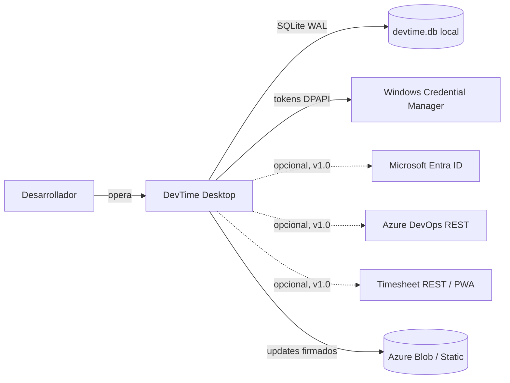
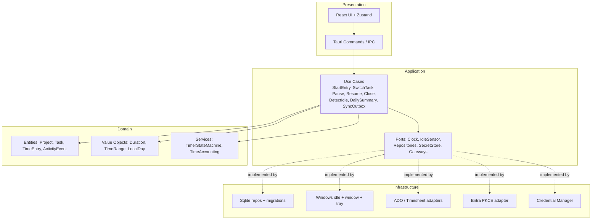
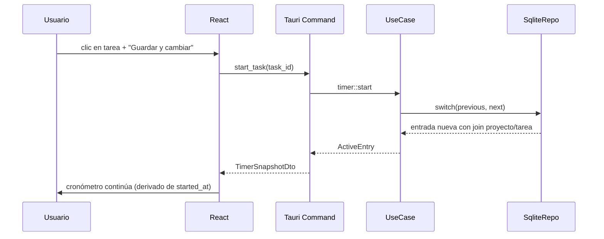
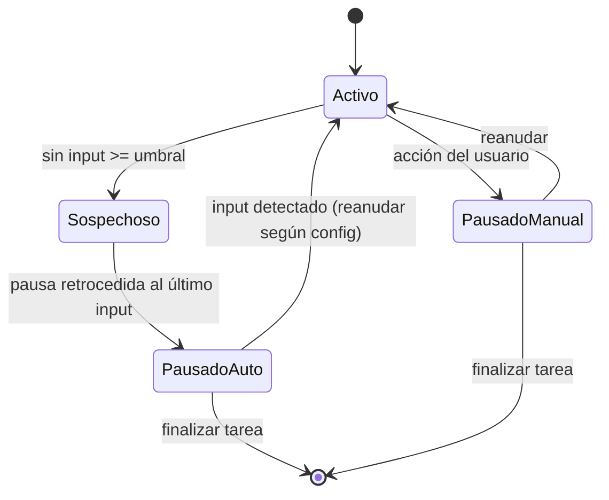

# Arquitectura de DevTime

## 1. Principios

1. **El tiempo es dato, no UI.** La duración se calcula desde marcas de tiempo persistidas;
   el tick de 1 s es solo presentación.
2. **UI fina, dominio robusto.** React no decide reglas de tiempo ni persistencia.
3. **Rust mínimo.** Solo lo que requiere el SO (ventana, idle, SQLite, secretos, HTTP).
4. **Hexagonal / Clean Architecture.** El dominio no conoce Tauri, SQLite ni HTTP.
5. **Offline-first.** Todo funciona sin red; la sincronización es un efecto posterior.
6. **Cero sorpresas.** Nada automático que cambie datos sin acción o consentimiento.
7. **Privacidad por diseño.** Se guarda el tiempo y metadatos mínimos, nunca contenido.

## 2. Vista de contexto



## 3. Capas y dependencias



Regla de dependencia: `domain ← application ← infrastructure/presentation`. El dominio no
importa ningún crate de infraestructura. Los puertos viven en `application` (o `domain` si son
conceptos puros, como `Clock`).

### Crate layout

| Crate | Responsabilidad | Dependencias permitidas |
|-------|-----------------|--------------------------|
| `devtime-domain` | Entidades, value objects, máquina de estados, aritmética de tiempo | std + `serde`/`thiserror` (`time`/`uuid` cuando hagan falta) |
| `devtime-application` | Casos de uso, puertos, DTOs de aplicación, errores de negocio | domain + `serde_json`/`thiserror` |
| `devtime-infrastructure` | SQLite, OS Windows, HTTP, PKCE, secretos, reloj real | domain, application |
| `apps/desktop/src-tauri` | Composición, comandos IPC, ventanas, tray, ciclo de vida | todas |
| `apps/desktop/src` | React/TS, sin lógica de negocio | contrato IPC generado |

## 4. Flujos de ejecución

### 4.1 Inicio de jornada



### 4.2 Tick del cronómetro

No hay escritura por segundo. La UI calcula:

```
elapsed = accumulated_seconds + (status == running ? now - last_resumed_at : 0)
```

El `setInterval(1000)` vive en React y solo recalcula la cifra; no hay escritura por segundo.
Además, `useTimer` refresca el snapshot completo cada 15 s para reconciliar con el backend.
Detener el tick con la ventana oculta y corregir deriva con `setTimeout` quedan pendientes de F3/F4.

### 4.3 Inactividad



- Rust consulta `GetLastInputInfo` cada 30 s (coste ~0).
- Al superar el umbral, el caso de uso pausa la entrada **en el timestamp del último input**,
  no en el momento de detección: nunca se factura tiempo inactivo.
- No se muestra popup. El indicador cambia a ámbar y el tooltip explica el estado.
- Al volver el input: por defecto se ofrece reanudar con un clic (estado visible), configurable
  a reanudación automática.

### 4.4 Cierre inesperado

Al arrancar, si existe una entrada `running` cuyo último latido quedó atrás (> 120 s):

1. Se calcula el tiempo hasta el último heartbeat de actividad conocido (o hasta el último
   input registrado), no hasta "ahora".
2. **Implementado en F2:** la entrada pasa a `paused` con `accumulated_seconds` cortado en
   `last_heartbeat_at`; no se cuentan las horas con la app cerrada.
3. **Pendiente:** marcar `source = 'recovered'`, registrar el evento en `activity_history` y
   mostrar el aviso en el resumen diario.

Heartbeat: cada 60 s, si hay entrada activa, se actualiza `last_heartbeat_at` (una escritura
barata) desde un hilo dedicado en la app Tauri. Así la recuperación no infla horas por un equipo
apagado toda la noche.

## 5. Ventana y estados

| Estado | Tamaño (lógicos) | Comportamiento |
|--------|------------------|----------------|
| Compacto | 132×28 | **Implementado:** always-on-top, sin decoración, arrastrable; incluye botón iniciar/pausar/reanudar |
| Hover | 264×92 | **Pendiente F3:** se expande 150 ms tras entrar; colapsa 400 ms después de salir |
| Switcher | 320×440 | **Pendiente F3:** se abre con clic en el tiempo; búsqueda y teclado |
| Minimizado | 28×28 | **Pendiente F4:** solo icono/punto de estado |
| Alerta contexto | Compacto + borde ámbar | **Pendiente F7:** no cambia tamaño ni foco |
| Resumen | 560×620 | **Pendiente F4:** ventana normal, centrada, se puede minimizar |
| Ajustes | 720×560 | **Pendiente F5:** ventana normal con decoración estándar |

Decisiones:
- **Una sola ventana redimensionable** para compacto/hover/switcher (evita parpadeo de múltiples
  ventanas). Ventanas separadas solo para ajustes y resumen.
- Anclaje: se conserva la esquina superior izquierda; si se sale del área de trabajo, se hace
  clamp al monitor más cercano. Soporte DPI por monitor.
- `alwaysOnTop`, `skipTaskbar`, `decorations: false`, `transparent: true`, `focus: false` al crear.
- El foco solo se toma cuando el usuario hace clic (búsqueda del switcher). Nunca por timers.
- Pantalla completa (juegos/presentaciones): la ventana se oculta automáticamente (detección de
  `SHQueryUserNotificationState`), configurable.

## 6. Decisiones de arquitectura (ADR resumidas)

| ID | Decisión | Alternativas | Consecuencia |
|----|----------|--------------|--------------|
| ADR-01 | Tauri 2 en lugar de MAUI/Electron | MAUI, Electron, WinUI | Binario y RAM mínimos; requiere Rust y WebView2 |
| ADR-02 | Tiempo derivado de marcas persistidas | Contador en memoria | Recuperable y auditable; sin drift |
| ADR-03 | SQLite WAL con escritor único | JSON files, RocksDB | Transaccional, simple, probado; serializar escrituras |
| ADR-04 | Outbox transaccional para sync | Envío directo al cerrar | Offline-first e idempotente; algo más de código |
| ADR-05 | Tokens en Credential Manager, DB sin secretos | SQLCipher, archivo cifrado | Menor superficie; DB no cifrada en MVP (Q3) |
| ADR-06 | IPC tipado generado (`tauri-specta`) | strings JSON manuales | Contrato seguro en compilación; una dependencia más |
| ADR-07 | Zustand + CSS Modules | Redux, Tailwind | Bundle pequeño y control total de transparencia |
| ADR-08 | Un solo proceso, polling de idle cada 30 s | hooks de input globales | Sin hooks invasivos ni CPU; error ≤ 30 s |
| ADR-09 | Detección de contexto solo sugiere | auto-switch | Confianza del usuario; menos errores |
| ADR-10 | Exportar CSV en MVP, sync en v1.0 | sync temprano | Valor inmediato sin depender de contrato externo |

## 7. Presupuestos no funcionales

| Métrica | Presupuesto | Medición |
|---------|-------------|----------|
| CPU inactiva (30 min) | ≤ 0.5 % de un núcleo | Línea base F1: **0.42 %** a 30 s (release) |
| RAM privada total | ≤ 150 MB (app + WebView2); objetivo 100 MB en F5 | Línea base F1: **128 MB** (app 5 MB + WebView2 123 MB) |
| Arranque a interactivo | ≤ 1.5 s en caliente, ≤ 2.5 s en frío | Pendiente de instrumentar en F5 |
| Escritura DB (p95) | ≤ 10 ms | instrumentación de repos |
| Apertura de switcher | ≤ 100 ms percibidos | Playwright trace + perfil |
| Tamaño instalador | ≤ 15 MB | artefacto CI |
| Pérdida máxima ante crash | ≤ 60 s | prueba de kill -9 |

## 8. Manejo de errores

- Errores de negocio (`DomainError`) con código estable (`ENTRY_ALREADY_RUNNING`,
  `TASK_NOT_FOUND`, `OVERLAP_NOT_ALLOWED`) y mensaje en español para UI.
- Errores de infraestructura se envuelven con contexto y se registran **sin PII ni tokens**.
- La UI nunca muestra stack traces; ofrece acción ("Reintentar", "Ver detalle").
- Los fallos de sync no bloquean el registro local.

## 9. Zona horaria y tiempo

- Persistencia en **epoch milisegundos UTC**; el día local se deriva con zona del sistema.
- El "resumen diario" usa el día local al momento de la consulta.
- Cambios de hora/DST: la duración se calcula por diferencia absoluta de instantes (correcto
  por definición); el agrupamiento por día usa la fecha local del inicio de cada entrada.
- Entradas que cruzan medianoche se reportan al día de inicio (regla por defecto, configurable
  en v1.0 si el Timesheet exige corte).

## 10. Extensibilidad prevista

- Nuevos adaptadores de Timesheet: implementar el puerto, registrar en composición, sin tocar
  dominio ni UI.
- Detección de contexto v2.0: nuevo puerto `ContextSensor` + caso de uso de sugerencias.
- Reportes v3.0: consultas de lectura/views; no alteran el camino crítico de registro.

## 11. Estado de implementación (2026-11-25)

**Implementado y verificado**
- F1: monorepo Tauri 2.12 + React 19/TS/Vite 6 + SQLite WAL con migración embebida, CSP estricta,
  CI escrita y build release (4.00 MB).
- F2: `TimeEntry` con `recover_if_stale`; puertos `TimeEntries`/read models; casos de uso
  `start/pause/resume/close/recover_stale/today_totals`; repositorio SQLite con `switch`
  transaccional; workspace `General` por defecto; comandos IPC y UI conectada; heartbeat 60 s.
- Presupuestos medidos: CPU inactiva 0.42 % de un núcleo; RAM privada total ~128 MB.

**Pendiente**
- Project/Task como entidades de dominio con CRUD y repositorios; `ActivityEvent`.
- Detección de solapamientos, pruebas de propiedad/concurrencia y cobertura 80/70.
- F3: switcher, menú contextual, hover, posición recordada y atajos.
- F4: inactividad, resumen diario, tray, autostart y export CSV.
- Primera ejecución del pipeline de Azure.
