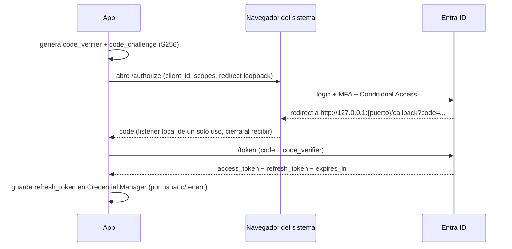
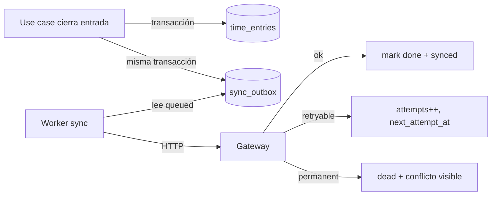

# Integración empresarial

La app debe funcionar **sin red** y sincronizar cuando pueda. Toda integración externa es un
adaptador detrás de un puerto; el dominio no cambia al agregar un proveedor.

## 1. Puertos (application layer)

```rust
pub trait Clock: Send + Sync { fn now_utc_ms(&self) -> i64; }
pub trait ActivityRepository { /* time entries, projects, tasks, activity */ }
pub trait PreferencesRepository { /* key-value tipado */ }

pub trait IdentityProvider {
    fn sign_in_interactive(&self) -> Result<Session, IdentityError>;
    fn acquire_token_silent(&self) -> Result<Option<Token>, IdentityError>;
    fn sign_out(&self) -> Result<(), IdentityError>;
}

pub trait WorkItemSource {
    fn list_projects(&self) -> Result<Vec<ExternalProject>, IntegrationError>;
    fn list_work_items(&self, project_id: &str) -> Result<Vec<ExternalWorkItem>, IntegrationError>;
}

pub trait TimesheetGateway {
    fn submit_entries(&self, batch: &[TimesheetEntry]) -> Result<SubmitReceipt, IntegrationError>;
    fn get_period_status(&self, period: &Period) -> Result<PeriodStatus, IntegrationError>;
}

pub trait SecretStore {
    fn set(&self, key: &str, value: &[u8]) -> Result<(), SecretError>;
    fn get(&self, key: &str) -> Result<Option<Vec<u8>>, SecretError>;
    fn delete(&self, key: &str) -> Result<(), SecretError>;
}
```

Adaptadores previstos:

| Puerto | MVP | v1.0 | Producción |
|--------|-----|------|------------|
| `TimesheetGateway` | `CsvExportAdapter` | `PwaTimesheetAdapter` / `RestTimesheetAdapter` | Contrato Q1 |
| `IdentityProvider` | `NoopIdentity` | `EntraPkceAdapter` | App Registration Q2 |
| `WorkItemSource` | `LocalProjectSource` (CRUD manual) | `AdoRestAdapter` (REST 7.x) | Pat / OAuth |
| `SecretStore` | `CredentialManagerAdapter` | igual | DPAPI |
| `Clock` | `SystemClock` | igual | — |
| `IdleSensor` | `Win32IdleSensor` | igual | — |

## 2. Microsoft Entra ID — flujo

Se usa **Authorization Code + PKCE** con el navegador del sistema (nunca un WebView embebido,
que rompe políticas y Condicional Access).



Reglas:
- `redirect_uri` loopback (`http://127.0.0.1`), puerto efímero, listener efímero.
- Scopes mínimos: `openid profile offline_access` + scopes de ADO/Timesheet necesarios.
- Refresh **silencioso** antes de expirar; refresh token rotativo: si falla, re-login discreto.
- Un solo tenant; validar `tid` y `iss`.
- Nunca registrar tokens; redactar `Authorization` en logs.
- Caché de tokens en memoria; persistencia solo del refresh token en Credential Manager.

## 3. Azure DevOps

- Base: `https://dev.azure.com/{org}` (o `https://{org}.visualstudio.com`).
- Endpoints:
  - `GET /_apis/projects?api-version=7.1`
  - `GET /{project}/_apis/wit/wiql?api-version=7.1` (consulta de work items asignados)
  - `GET /_apis/wit/workitems?ids=...&api-version=7.1`
- Mapeo: `external_id` = id del work item; `task_type` según `System.WorkItemType`;
  `title` = `System.Title`; estado desde `System.State`.
- Filtro por defecto: asignados al usuario, estado no cerrado, iteración actual (configurable).
- Sincronización de work items **solo lectura** en v1.0; no se modifica ADO.
- Rate limiting: respetar `Retry-After`, backoff exponencial con jitter, caché de 15 min.

## 4. Timesheet corporativo

Contrato real pendiente (Q1). El puerto se diseña así:

```json
{
  "period": { "from": "2026-11-23", "to": "2026-11-23" },
  "entries": [
    {
      "idempotencyKey": "018f...-entry-42",
      "projectExternalId": "ACTIVA",
      "taskExternalId": "542",
      "startedAt": "2026-11-23T13:02:11Z",
      "durationSeconds": 3720,
      "note": null,
      "billable": true
    }
  ]
}
```

Reglas:
- **Idempotencia obligatoria:** la clave se genera al crear la entrada
  (`uuidv7:entry_id`) y viaja en cada reintento y en `sync_outbox`.
- **Granularidad:** se envía por entrada o agregado diario según exija el Timesheet
  (configurable); nunca se pierde el detalle local.
- **Estados locales:** `local → pending → synced | failed | conflict`.
- **Conflicto:** si el servidor ya tiene horas para el periodo:
  - `server_wins_after_submit`: una vez enviado, el local no reenvía sin confirmación.
  - `local_wins_pre_submit`: antes de enviar, el local es la verdad.
  - Todo conflicto se muestra en el resumen diario con acción ("Revisar").
- **Borradores:** el envío puede ser "borrador" o "definitivo" si el sistema lo permite.

## 5. Patrón Outbox



- La escritura de la entrada y del evento outbox ocurren en **una sola transacción**: no existe
  hora registrada sin intención de sincronizar.
- Reintentos: exponencial `min(30s * 2^n, 6h)` con jitter; máximo configurable (p. ej. 12).
- `state = dead` para errores permanentes (400 de validación); requiere intervención o descarte.
- El worker corre solo con red y sesión válida; nunca bloquea la UI.
- Al recuperar conectividad, se procesa en lote ordenado por `next_attempt_at`.

## 6. Taxonomía de errores

| Tipo | Ejemplo | Acción |
|------|---------|--------|
| Transitorio | 429, 503, timeout, red caída | Reintentar con backoff |
| Autenticación | 401, refresh inválido | Refrescar; si falla, pedir login |
| Autorización | 403, scope faltante | No reintentar; avisar configuración |
| Validación | 400, campo inválido | `dead`; mostrar detalle y permitir corregir |
| Conflicto | 409, periodo cerrado | Marcar `conflict`; decisión del usuario |
| Servidor | 500 | Reintentar limitado; degradar a local |

## 7. Seguridad y cumplimiento en integraciones

- TLS 1.2+ obligatorio; respetar proxy corporativo del sistema; nunca desactivar validación de
  certificado.
- Sin secretos en URL; tokens solo en cabecera `Authorization: Bearer`.
- Minimización: no se envían títulos de ventana, rutas de archivos ni contenido de trabajo.
- Auditoría local (`activity_history` + `sync_outbox`) para explicar cada hora enviada.
- Feature flags por proveedor para habilitar integraciones en piloto sin rebuild.

## 8. Estrategia de pruebas de integración

- `MockTimesheetServer` (wiremock) con escenarios: éxito, 401, 429, 409, 500, timeout.
- Pruebas de contrato contra sandbox cuando exista (Q1/Q2).
- Pruebas de idempotencia: enviar dos veces el mismo lote no duplica horas.
- Pruebas offline: cortar red, cerrar entradas, reconectar y verificar orden y totales.
- Pruebas de rotación de refresh token y expiración.
