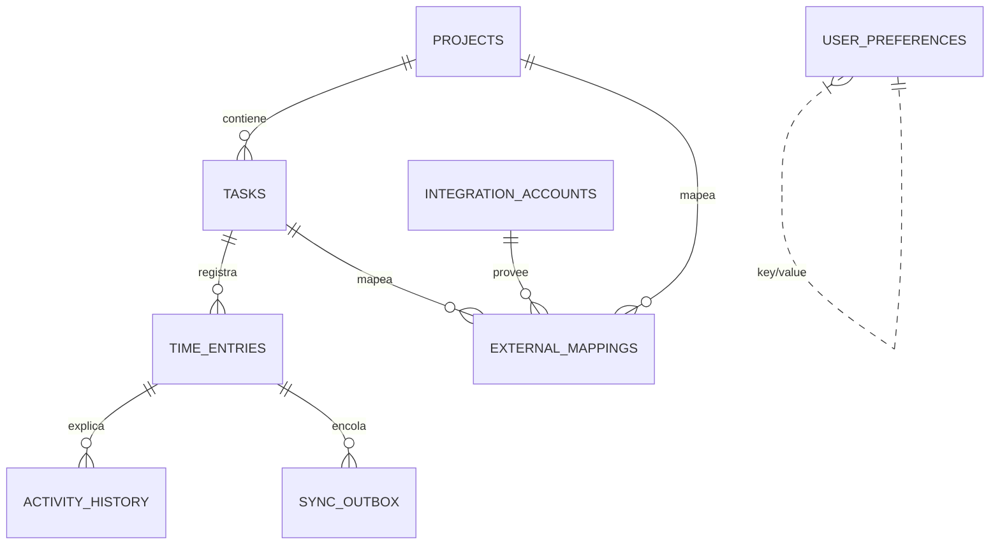

# Modelo de datos (SQLite)

DDL canónico: [`db/migrations/0001_init.sql`](../../db/migrations/0001_init.sql).
Este documento explica el **por qué** del esquema; el SQL es la referencia ejecutable.

## 1. Convenciones

- **IDs:** UUID v7 en `TEXT` (ordenable, seguro para sincronizar, sin colisiones).
- **Tiempo:** epoch **milisegundos UTC** en columnas `*_at` (`INTEGER`). El día local se deriva
  con la zona del sistema.
- **Borrado:** lógico con `deleted_at` en catálogos (`projects`, `tasks`); las entradas de tiempo
  nunca se borran (auditoría), se corrigen o se marcan.
- **Booleanos:** `INTEGER 0/1` con `CHECK`.
- **Enums:** `TEXT` con `CHECK IN (...)` para legibilidad en consultas y exportaciones.
- **Escritor único:** un solo proceso (single-instance) y una conexión de escritura; lecturas
  pueden usar conexiones separadas. WAL permite convivencia.
- **Pragmas:** `journal_mode=WAL`, `synchronous=NORMAL`, `foreign_keys=ON`,
  `busy_timeout=5000`, `auto_vacuum=INCREMENTAL`.

## 2. Diagrama entidad-relación



`ACTIVITY_HISTORY` referencia opcionalmente una entrada; si la entrada se elimina (caso
excepcional), el evento conserva su historia con `SET NULL`.

## 3. Tablas

### 3.1 `projects`

Catálogo de proyectos. `code` es el identificador humano (ej. `ACTIVA`), `external_id` el del
sistema corporativo. `color` se usa en el switcher y reportes.

### 3.2 `tasks`

Tareas dentro de un proyecto. `external_id` es el work item de ADO o el id del Timesheet.
`status` distingue activas, cerradas y bloqueadas. `sort_order` permite orden manual; el
switcher ordena primero por uso reciente (consulta) y luego por `sort_order`.

### 3.3 `time_entries`

Corazón del sistema. Campos clave:

| Campo | Propósito |
|-------|-----------|
| `status` | `running` / `paused` / `closed` |
| `started_at` | inicio absoluto de la entrada (UTC ms) |
| `last_resumed_at` | instante del último `resume`; solo si está `running` |
| `accumulated_seconds` | tiempo acumulado antes de la última pausa |
| `ended_at` | cierre absoluto |
| `duration_seconds` | duración final congelada al cerrar |
| `source` | `manual`, `autoswitch`, `idle_pause`, `import`, `recovered` |
| `sync_state` | `local`, `pending`, `synced`, `failed`, `conflict` |
| `idempotency_key` | clave estable para envíos y reintentos |
| `last_heartbeat_at` | marca de vida para recuperación tras crash |

Invariantes garantizadas por la base:

1. **Una sola entrada `running`** en todo el sistema
   (`CREATE UNIQUE INDEX ... WHERE status = 'running'`).
2. Si `status = 'running'`, `last_resumed_at` no es nulo.
3. Si `status = 'closed'`, `ended_at`, `duration_seconds` existen y `last_resumed_at` es nulo.
4. `ended_at >= started_at`; `accumulated_seconds >= 0`; `duration_seconds >= 0`.

Cálculo de duración:

```
running:  accumulated_seconds + (now - last_resumed_at) / 1000
paused:   accumulated_seconds
closed:   duration_seconds
```

Los invariantes 1–4 se complementan con transacciones en los casos de uso; la base es la
última línea de defensa.

**Implementación actual (F2)**
- Los IDs de `time_entries` son UUID v7 generados en el borde Tauri (`Uuid::now_v7`).
- `source` se persiste como `manual`; `billable = 1`; `sync_state = 'local'`;
  `idempotency_key = id` de la entrada.
- `switch(previous, next)` ejecuta en una transacción el cierre de la entrada anterior y la
  inserción de la nueva; nunca hay dos `running`.
- Si no existe catálogo, `ensure_default_workspace` inserta `project-general` (`General`/`GEN`)
  y `task-general` (`Trabajo general`) para que la píldora funcione antes del switcher de F3.
- `activity_history` está creada pero todavía no se escribe (pendiente F2/F4).

### 3.4 `user_preferences`

Key-value con JSON validado por la aplicación. Ventajas: agregar preferencias sin migración y
versionar el documento (`schema_version` dentro del JSON). Claves previstas:

```
appearance.theme, appearance.opacity, appearance.accent, appearance.radius,
appearance.font, behavior.always_on_top, behavior.autostart, behavior.minimize_on_start,
behavior.remember_position, behavior.position, productivity.idle_minutes,
productivity.idle_action, productivity.context_detection, sync.provider,
sync.last_sync_at, privacy.telemetry_opt_in
```

### 3.5 `activity_history`

Bitácora local de eventos para explicar el tiempo (no telemetría). Tipos: `app_start`,
`app_stop`, `task_switch`, `idle_start`, `idle_end`, `focus_change`, `context_suggested`,
`context_dismissed`, `pause`, `resume`, `entry_closed`, `sync_attempt`, `sync_result`,
`recovered_entry`. `payload_json` **nunca** contiene contenido de trabajo: solo metadatos
(id de tarea, proceso, duración). Retención por defecto 90 días (configurable).

### 3.6 `sync_outbox`

Cola transaccional de sincronización: `state` (`queued`, `in_flight`, `done`, `dead`),
`attempts`, `next_attempt_at`, `idempotency_key` único, `last_error` sanitizado.

### 3.7 `integration_accounts`

Metadatos de cuentas conectadas. **No almacena tokens**: `credential_ref` apunta a la entrada
de Windows Credential Manager. `scopes` y `expires_at` son informativos para la UI.

### 3.8 `external_mappings`

Mapeo bidireccional entre entidades locales y externas, con `payload_hash` para detectar
cambios y evitar enviar datos sin modificar.

### 3.9 `schema_migrations`

Versión aplicada y checksum del script. El migrador se ejecuta al arrancar, dentro de una
transacción por versión.

## 4. Índices y su razón

| Índice | Consulta que sirve |
|--------|--------------------|
| `ux_time_entries_running` (parcial) | Garantiza una sola entrada activa |
| `ix_time_entries_task_started` | Historial por tarea / recientes |
| `ix_time_entries_started` | Resumen diario y solapamientos |
| `ix_time_entries_sync` (parcial) | Outbox/estado de sincronización |
| `ix_tasks_project` | Switcher ordenado por proyecto |
| `ix_tasks_updated` | Tareas usadas recientemente |
| `ix_activity_occurred` | Línea de tiempo y retención |
| `ix_outbox_ready` | Worker: siguiente lote listo |
| `ux_projects_code` | Código único legible |
| `ux_tasks_external` | Evita duplicar work items |
| `ux_mappings_*` | Idempotencia de mapeos |

## 5. Vistas

- `v_daily_totals`: total de segundos y número de entradas por día local, proyecto y tarea
  (solo cerradas). Base del resumen y export CSV. **Implementada y usada por
  `get_today_totals`.**
- `v_running_entry`: entrada activa con datos de proyecto/tarea para la UI. **Implementada.**
- La UI también necesita entradas `paused`; el repositorio hace un `JOIN` directo a
  `projects`/`tasks` y filtra `status IN ('running', 'paused')`, porque `v_running_entry`
  solo cubre `running`.

## 6. Consultas de referencia

```sql
-- Total del día local
SELECT task_id, SUM(duration_seconds) AS seconds
FROM time_entries
WHERE status = 'closed'
  AND date(started_at / 1000, 'unixepoch', 'localtime') = date('now', 'localtime')
GROUP BY task_id;

-- Solapamientos de una tarea (control de calidad)
SELECT a.id, b.id
FROM time_entries a
JOIN time_entries b
  ON a.id < b.id
 AND a.started_at < COALESCE(b.ended_at, b.started_at)
 AND b.started_at < COALESCE(a.ended_at, a.started_at)
WHERE a.task_id = b.task_id;
```

## 7. Migraciones y evolución

- Archivos `NNNN_descripcion.sql` embebidos en el binario (`include_str!`).
- Cada migración es **idempotente en intención** y se aplica una sola vez, en transacción.
- Prohibido editar una migración ya publicada: se agrega una nueva.
- Cambios de esquema requieren: DDL + actualización de este documento + pruebas de migración
  desde la versión anterior con datos representativos.
- Backup previo a migración: copia `devtime.db` a `backups/` (retención 3).
- **Estado F2:** esquema v1 aplicado; no hay migración `0002`. El workspace por defecto se
  crea por código, no por migración, para que sea idempotente en bases existentes.

## 8. Retención y mantenimiento

| Dato | Retención | Acción |
|------|-----------|--------|
| `time_entries` | Permanente (hasta exportación/archivo) | Nunca borrar automáticamente |
| `activity_history` | 90 días (configurable) | Purga diaria al arrancar |
| `sync_outbox` `done` | 30 días | Purga |
| Backups de migración | 3 últimos | Rotación |
| Logs locales | 14 días, sin PII | Rotación por tamaño |

Mantenimiento: `PRAGMA optimize` al cerrar la app; `wal_checkpoint(TRUNCATE)` tras purgas
grandes; `VACUUM` solo manual si el archivo crece anómalamente.

## 9. Privacidad del dato

- No se guardan títulos de ventana ni URLs completas en el MVP.
- En v2.0 (contexto) solo se persiste el **patrón** o proceso que originó una sugerencia, con
  retención corta y posibilidad de desactivar por completo.
- Exportaciones son locales y explícitas; no se suben a ningún lado sin acción del usuario.

## 10. Estado de implementación (2026-11-25)

| Elemento | Estado |
|----------|--------|
| Esquema v1 (`projects`, `tasks`, `time_entries`, preferencias, outbox, historial) | Aplicado por migración embebida |
| Repositorio de entradas | Implementado con `find_current`, `save`, `switch` y `daily_totals` |
| Workspace por defecto | Implementado (`General`/`GEN` + `Trabajo general`) |
| Vistas `v_daily_totals` / `v_running_entry` | Creadas; totales usados por IPC |
| CRUD de proyectos/tareas | Pendiente (F2/F3) |
| `activity_history` / `sync_outbox` | Esquema creado; escritura pendiente |
| Cifrado en reposo (Q3) | Pendiente de decisión; MVP sin cifrar |
