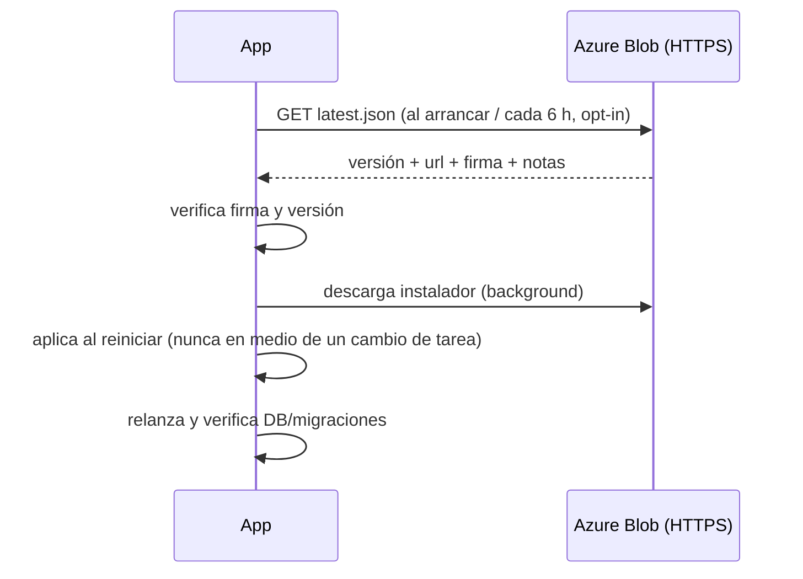

# Estrategia de despliegue

## 1. Artefactos

| Artefacto | Uso | Notas |
|-----------|-----|-------|
| `DevTime_x.y.z_x64-setup.exe` (NSIS) | Instalación estándar por usuario | Recomendado para Intune |
| `DevTime_x.y.z_x64_en-US.msi` | Instalación corporativa (WiX) | Per-user, sin admin |
| `latest.json` firmado | Manifiesto de auto-update | Servido por HTTPS |
| SBOM (CycloneDX) | Cumplimiento | Archivado por release |

Objetivo de tamaño: instalador ≤ 15 MB comprimido.

**Estado F1–F2:** todavía no se generan instaladores. `tauri build --no-bundle` produce
`target/release/devtime-desktop.exe` de **4.00 MB**; el bundle NSIS, la firma y el updater
quedan para F5.

## 2. Firma de código

- Azure Trusted Signing (preferido, integrado en Azure) o certificado EV.
- Firmar ejecutables, instaladores y el manifiesto de actualización.
- Timestamp RFC 3161 para validez tras expiración del certificado.
- Verificación post-firma en CI (`signtool verify /pa`).

## 3. Instalación

- **Por usuario** en `%LOCALAPPDATA%\Programs\DevTime`; datos en
  `%LOCALAPPDATA%\com.sipecom.devtime`.
- Sin elevación: si requiere admin, es un defecto de release.
- Desinstalación conserva datos por defecto; opción explícita "eliminar datos".
- Prerrequisito: WebView2 Runtime (presente en Windows 10/11 actualizado; bootstrapper si falta).
- Detección de versión y actualización in-place sin perder la DB.

## 4. Auto-update

Reglas:
- La descarga es silenciosa; **la aplicación** de la actualización ocurre al cerrar/reiniciar o
  con confirmación ("Actualizar ahora").
- Nunca interrumpir una entrada `running`: se conserva y se recupera.
- Migraciones de DB se ejecutan tras actualizar, con backup previo automático.
- Canales: `stable` (corporativo) y `beta` (piloto), seleccionables por política (no por UI
  en producción).

## 5. Distribución corporativa

- **Intune / Win32 app**: comando de instalación silenciosa (`/S` NSIS), detección por versión
  de archivo/registro, requisito WebView2.
- Alternativa: GPO/scripts de despliegue con MSI (`msiexec /i ... /qn`).
- Publicación inicial en un grupo piloto (IT + 5–10 devs) y luego oleadas por área.
- Documento de soporte: cómo verificar versión, logs, backup y reinstalación.

## 6. Entornos y secretos

| Entorno | Uso | Datos |
|---------|-----|-------|
| Dev | Local, IPC mockeado | Sintéticos |
| CI | Build/test/package | Sin secretos reales |
| Sandbox | Entra/ADO/Timesheet de prueba | Cuentas de prueba |
| Producción | Empleados | Datos reales, solo local + envío corporativo |

Secretos de CI en variable groups/Key Vault; nunca en el repo. Firma y credenciales de
publicación con acceso mínimo y rotación.

## 7. Versionado y releases

- **SemVer** `MAJOR.MINOR.PATCH`; `0.x` durante MVP, `1.0.0` al integrar Timesheet.
- Release notes en español, orientadas a beneficio ("Cambia de tarea en 2 clics").
- Tag `vX.Y.Z` dispara el pipeline de release; artefactos inmutables.
- Hotfix: rama desde tag, parche, release PATCH y rollback del canal si es necesario.

## 8. Rollback

1. Identificar versión problemática (opt-in crash reports o reporte de soporte).
2. Republicar `latest.json` apuntando a la versión anterior (downgrade permitido en hotfix).
3. Si hubo migración de DB incompatible, publicar versión de reparación (nunca downgrade de
   esquema).
4. Comunicar a los usuarios y registrar en la bitácora.

## 9. Operación y soporte

- Diagnóstico local: "Exportar diagnóstico" genera ZIP con logs saneados, versión, estado de
  DB y preferencias (sin tokens ni títulos de ventana).
- Monitoreo: opt-in de fallos de arranque y actualización; métricas agregadas, sin PII.
- SLA piloto: respuesta < 1 día hábil; canal definido con IT.
- Capacitación: guía de 1 página + video de 2 min + onboarding in-app.

## 10. Checklist de release

- [ ] Versión y changelog actualizados.
- [ ] Build firmado y verificado; SBOM adjunto.
- [ ] Auto-update probado desde la versión publicada anterior.
- [ ] Migración de DB probada con copia real anonimizada.
- [ ] Instalación limpia, actualización y desinstalación verificadas.
- [ ] Rollback documentado y `latest.json` de respaldo listo.
- [ ] Aviso interno y notas de release enviados.

## 11. Estado actual de artefactos (2026-11-25)

| Artefacto | Estado | Evidencia |
|-----------|--------|-----------|
| Ejecutable debug | Generado | `tauri build --no-bundle --debug`; E2E con clic real |
| Ejecutable release | Generado | 4.00 MB; build en 2m 59s; E2E `running` → `paused` |
| Instalador NSIS/MSI | Pendiente F5 | `bundle.active = true`, sin ejecutar |
| Firma, SBOM, `latest.json` | Pendiente F5 | Sin pipeline de release |
| CI de Azure | Escrito, sin ejecutar | `azure-pipelines.yml` |
| Auto-update / Intune | Pendiente F5 | Estrategia definida |
